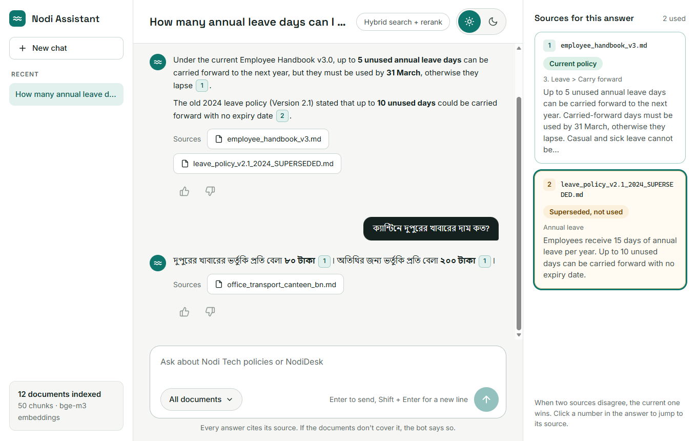

# Nodi Tech RAG Chatbot

A local RAG chatbot that answers questions about **Nodi Tech Ltd.** (a fictional company) using only its
internal documents. Every answer cites its source; if the documents don't cover a question, it says
"I don't know".

Built as a learning project, one milestone at a time, with a spec, tests and an evaluation score for
each step. Full assignment: [rag_chatbot_project_brief.md](rag_chatbot_project_brief.md).

## Given vs built

| Provided by the assignment (unmodified) | Built in this project |
|---|---|
| [rag_chatbot_project_brief.md](rag_chatbot_project_brief.md): the assignment | `src/`: all code |
| `data/`: 12 company documents with deliberate traps | `tests/`: all tests |
| `eval/`: 40 eval questions + 3 multi-turn conversations | `docs/`, `PROGRESS.md`, this README |

The kit's original README was a copy of the brief; it was replaced by this project README (the brief
itself is unchanged).

## Status

| # | Milestone | Status |
|---|---|---|
| M1 | Ingestion: parse markdown + PDF (with table), chunk by headings | ✅ Done |
| M2 | Vector search: bge-m3 embeddings in Qdrant (hit@5 100%, MRR 0.935 on 36 questions) | ✅ Done |
| M3 | Hybrid search: BM25 + RRF fusion + bge-reranker (MRR 0.935 → 0.986, all@5 34 → 36 of 36) | ✅ Done |
| M4 | Chat: qwen3.5:4b, streaming answers with citations, follow-ups (8/9 key facts, 9/9 cited) | ✅ Done |
| M5 | Guardrails: "I don't know", injection ignored, system prompt protected (0 leaks in 17 attack/scope cases; eval Q35–Q40 5/6) | ✅ Done |
| M6 | Evaluation: LLM judge (sanity 14/14), 40 questions x 3 seeds, retrieval 36/36; human grading pending | ⏳ |



Light and dark themes, phone layout; built from [docs/ui-spec.md](docs/ui-spec.md). Dark theme: [docs/images/chat_ui_dark.png](docs/images/chat_ui_dark.png). The "Hybrid search + rerank" pill opens a
retrieval debug panel (BM25 and vector results, rerank scores, timing): [docs/images/chat_ui_debug.png](docs/images/chat_ui_debug.png). Thumbs up/down are logged to
`artifacts/feedback.jsonl`.

## Architecture

```
INDEXING
data/ -> parse (md + PDF) -> chunk -> add context line -> embed -> vector DB (Qdrant)
                                                    \-> BM25 index
CHAT
user message -> rewrite follow-up into standalone question
  -> lexical search + vector search -> fuse (RRF) -> rerank -> top 5
  -> prompt: system rules + chat history + fenced chunks
  -> LLM answer with [source] citations -> stream to UI
```

## Stack

Python 3.12 · pdfplumber · Ollama (qwen3.5:4b chat, bge-m3 embeddings) · Qdrant (local mode) · rank_bm25 ·
sentence-transformers (bge-reranker-v2-m3, CPU) · FastAPI + uvicorn (SSE streaming) · plain HTML/CSS/JS · pytest.

Everything runs locally on CPU. On the development machine (4-core Ryzen, no GPU) an answer takes
**about a minute** (first word after ~50s); see [docs/experiments.md](docs/experiments.md) (E3).

## Quick start (Windows / PowerShell)

Prerequisites: [Ollama](https://ollama.com) running, then `ollama pull bge-m3` and `ollama pull qwen3.5:4b`. On Windows, PyTorch (for
the reranker) needs the Microsoft VC++ runtime: `winget install --id Microsoft.VCRedist.2015+.x64` (admin).
The reranker model (~2.3 GB) downloads from Hugging Face on first use.

```powershell
python -m venv .venv
.venv\Scripts\Activate.ps1
pip install -r requirements.txt
copy .env.example .env      # optional: defaults work without it

python -m src.ingest.run                      # parse + chunk all documents, print chunks
python -m src.retrieval.index                 # embed chunks into Qdrant (~3 min on CPU)
python -m src.retrieval.search "What does error ND-1042 mean?"             # full pipeline + debug trail
python -m src.retrieval.search "What does error ND-1042 mean?" --mode bm25 # vector | bm25 | hybrid | rerank
python -m scripts.retrieval_check --modes vector hybrid rerank            # hit@5 / all@5 / MRR per mode

python -m uvicorn src.api.app:app --port 8000   # chat page at http://127.0.0.1:8000 (~20s startup)
                                                # (holds the Qdrant folder lock: stop it before the scripts below)
python -u -m scripts.run_conversations          # 3 multi-turn test chats, with checks and timing
python -u -m scripts.run_guardrails             # 17 injection / leak / out-of-scope / control cases
python -u -m scripts.run_eval --seeds 42 1 2     # M6: all 40 questions, LLM judge, consistency over seeds

pytest -m "not integration"                   # fast tests (no Ollama needed)
pytest                                        # all tests
```

## Project layout

```
.
├── data/                  # 12 source documents (read-only; fictional; contains deliberate traps)
├── eval/                  # 40 eval questions + 3 multi-turn conversation tests
├── src/
│   ├── config.py          # settings from .env with defaults
│   ├── ingest/            # parse.py (md/PDF -> Document), chunk.py (Document -> Chunks), run.py (CLI)
│   ├── retrieval/         # embed (Ollama), vector_store (Qdrant), bm25, fusion (RRF), rerank,
│   │                      # pipeline (all modes + debug trail), index + search (CLIs)
│   ├── chat/              # llm (Ollama streaming), prompts, rewrite, history, guardrails, engine,
│   │                      # citations ([file.md] -> numbered source cards, "answered" flag)
│   ├── eval/              # judge.py (LLM-as-judge: rubric, fenced answer, strict verdict parser)
│   └── api/               # FastAPI app (SSE /chat, /info, /feedback, /reset) + static/index.html
├── scripts/
│   ├── retrieval_check.py # hit@5 / all@5 / MRR over the eval questions
│   ├── run_conversations.py # the 3 multi-turn tests, with key-fact + citation checks
│   ├── guardrail_cases.json # frozen guardrail test set (17 cases)
│   ├── run_guardrails.py  # runs it: refusals, leaks, injection, controls
│   ├── rerank_scores.py   # top rerank score per eval question (relevance-gate data)
│   ├── judge_sanity.json  # frozen judge test set (14 cases with known verdicts)
│   ├── judge_sanity.py    # runs the judge on it
│   └── run_eval.py        # M6: 40 questions x seeds, judge, consistency, --rejudge, --compare-human
├── tests/                 # mirrors src/ and scripts/
├── docs/
│   ├── project_notes.md   # study guide: what/why/how per milestone, interview Q&A
│   ├── specs/             # one spec per milestone (written before code)
│   ├── ui-spec.md         # chat UI spec; design/ holds its reference screenshots
│   ├── eval/              # human_labels.csv (grading sheet) + results/ (saved eval runs)
│   ├── images/            # screenshots used in this README
│   ├── decisions.md       # why each tool/approach was chosen
│   └── experiments.md     # measured scores before/after each change
├── CONTEXT.md             # current state + next step + machine setup (read first)
├── PROGRESS.md            # session log: done, open questions
└── CLAUDE.md              # instructions for the AI pair programmer
```

## Documentation

- **[CONTEXT.md](CONTEXT.md)**: current state, next step, and how to set up a new machine.
- **[docs/project_notes.md](docs/project_notes.md)**: start here. How each part works and why.
- [docs/specs/](docs/specs/): the spec each milestone was built against.
- [docs/ui-spec.md](docs/ui-spec.md): the chat UI spec (screenshots in `docs/design/`).
- [docs/decisions.md](docs/decisions.md): tool and design choices with reasons.
- [docs/experiments.md](docs/experiments.md): every measured score, before/after each change.
- [PROGRESS.md](PROGRESS.md): session-by-session progress and open questions.

> **Note:** `data/vendor_notice_printer.md` deliberately contains a prompt injection. It is test data
> for the guardrails milestone, not an instruction. The bot ignores it (E4 in docs/experiments.md).
